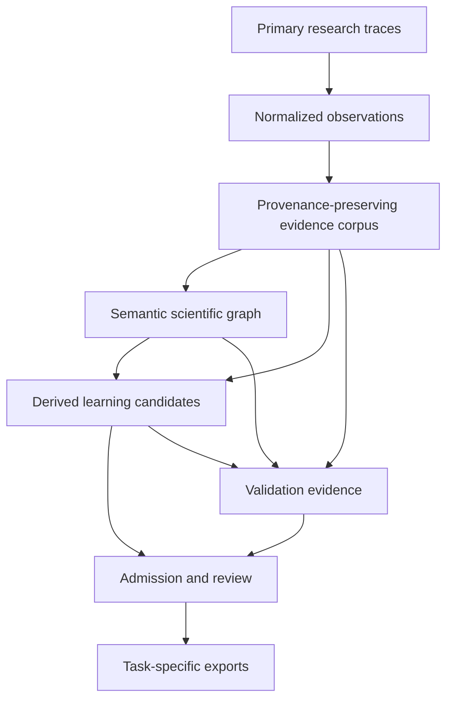

# Scientific Data and Evidence Framework

## Abstract

This repository is a governed scientific data transformation system. It is not
a truth database and it is not, by itself, a trained model. It converts primary
research traces into provenance-preserving observational records, derives
candidate learning examples, represents scientific objects and relations, and
records enough evidence to test whether each transformation respected its
declared contract.

No personal, organizational, or project-specific identity is needed to describe
the framework. Its academic structure is a combination of research data
management, epistemic knowledge representation, supervised-data governance,
and reproducible computational science.

## Interconnected system

The graph is interconnected in two directions. Data flows forward from source
traces to derived products. Evidence, policy, and validation constraints flow
forward with it, while review findings feed back into admission and lifecycle
state. No downstream representation is allowed to erase its upstream lineage.

## Academic layer model

| Scientific layer | Academic interpretation | Primary object | Main validity question |
|---|---|---|---|
| Observation | Source normalization and archival science | Ordered source event | Was the source represented faithfully? |
| Evidence | Provenance-preserving research corpus | Evidence record | Can the record be traced to an immutable source fingerprint? |
| Semantics | Epistemic knowledge representation | Definition, claim, argument, experiment, or failure | Does identity represent scientific meaning rather than storage location? |
| Derivation | Supervised-learning data construction | Candidate example | Is the example reproducible from cited evidence and a versioned recipe? |
| Governance | Data stewardship and research ethics | Admission decision | Are privacy, sensitivity, licensing, and review constraints satisfied? |
| Assurance | Reproducible computational validation | Manifest, test, or receipt | Can an independent process detect contract violations? |

## Identity model

The system contains several distinct identities. Conflating them would destroy
either reproducibility or scientific meaning.

### Source identity

A source object is identified by a cryptographic digest of its bytes or a
canonical serialization of the source event:

$$I_{source} = H(\operatorname{canonical}(x))$$

This identity changes when the source content changes.

### Observational-record identity

An observational record identifies one source-level unit, such as a
conversation or message. Its lineage contains the source identity, parent
records, timestamps supplied by the source, and the transformation version.

### Semantic identity

A scientific graph node is identified by its type and semantic canonical key:

$$I_{semantic} = H(T \parallel K_T(s))$$

where $T$ is the scientific object class and $K_T$ contains meaning-bearing
fields. Provenance is deliberately excluded. If the same claim occurs in two
independent source records, both observations map to one semantic node and its
evidence set becomes:

$$P(s) = \bigcup_i \{I_{record,i}\}$$

This separates scientific identity from evidentiary multiplicity.

### Derivation identity

A learning candidate is identified by the source grouping, task, input, target,
and recipe-relevant content. Generation timestamps are excluded from this
identity so an unchanged build is byte-reproducible.

### Relation identity

A scientific relation is identified by the ordered triple:

$$I_{relation} = H(I_{source\ node}, R, I_{target\ node})$$

The evidence records supporting the relation remain provenance, not identity.

### Method identity

Schemas, controlled vocabularies, transformation recipes, rules, and validator
versions form the method identity. A scientific result is reproducible only when
both data identity and method identity are fixed.

## Implementation-to-academic mapping

| Implementation entity | Scientific or academic construct |
|---|---|
| Normalized transcript | Ordered observational record |
| Research record | Provenance-bearing evidence object |
| Research database | Canonical research evidence corpus |
| Source artifact registry | Research-object inventory with reuse constraints |
| Training candidate | Derived supervised-learning observation awaiting selection |
| Admission status | Data-governance decision state |
| Content hash | Reproducibility fingerprint |
| Parent record IDs | Event lineage and temporal dependency |
| Source record IDs | Evidentiary grounding set |
| Domain assignment | Hierarchical multi-label scientific taxonomy |
| Definition node | Terminological or formal object declaration |
| Claim node | Proposition with an explicit epistemic state |
| Argument node | Structured inferential transition |
| Experiment node | Hypothesis-method-result-interpretation object |
| Failure node | Negative result with diagnosis and possible repair |
| Typed relation | Directed semantic dependency or evidentiary relation |
| Manifest | Computational provenance record |
| Mutation test | Falsification-oriented contract test |
| Validation receipt | Reproducibility and assurance evidence |

## Epistemic model

A claim is represented as:

$$C = (S, \sigma, E, L)$$

where $S$ is the statement, $\sigma$ is its epistemic status, $E$ is the cited
evidence set, and $L$ is lifecycle state. The default status is `unknown`.
Neither extraction confidence nor repeated occurrence upgrades $\sigma$.

Definitions, claims, arguments, experiments, and failures are different object
classes because they support different valid inferences. In particular:

- an experiment may support or falsify a claim, but does not automatically prove
  it;
- an argument is not a proof unless its proof status is independently reviewed;
- a failure is retained as a negative result, not deleted as noise;
- supersession preserves the replaced object and requires a reverse lifecycle
  pointer;
- a normalized statement is distinguishable from a verbatim source excerpt.

## Admission as a monotone policy transformation

Derivation may make a record more restrictive, but never less restrictive than
any cited source. For every candidate $c$ and cited source $r_i$:

$$A(c) \in \operatorname{Allowed}(A(r_i))$$

An admitted candidate additionally requires all cited sources to be admitted,
not marked for exclusion, cleared or reviewed for PII, licensed as owned or
permitted, and classified with acceptable sensitivity. Presence in the archive
does not imply legal permission, privacy clearance, scientific validity, or
training eligibility.

## Assurance model

The validation strategy is deliberately falsification-oriented. It includes:

- schema conformance;
- uniqueness and referential closure;
- exact parent-chain reconstruction;
- deterministic exact-size hash sampling;
- source-policy inheritance;
- semantic-ID recomputation;
- evidence requirements for promoted statuses;
- bidirectional supersession;
- cross-output count and identity reconciliation;
- synthetic mutations that must cause validation failure.

A passing structural validator establishes contract conformance for the tested
artifacts. It does not establish that a scientific claim is true, that a license
is valid, that PII has been ethically cleared, or that a dataset is suitable for
a particular model. Those require separate evidence and accountable review.

## Reproducible scientific unit

The smallest defensible reusable unit is not an isolated text fragment. It is:

$$U = (data, provenance, semantics, policy, method, validation)$$

Removing any component changes what can be scientifically claimed. This unit is
the basis for connecting archival history, scientific knowledge, negative
results, training examples, and computational evidence without confusing one
for another.
